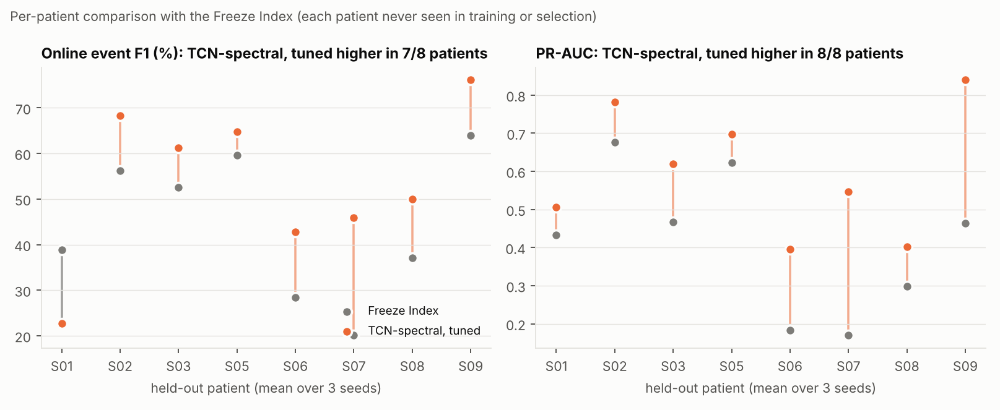
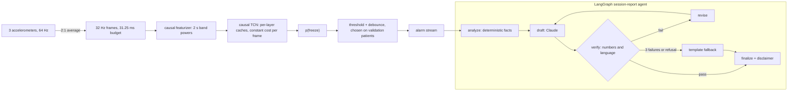
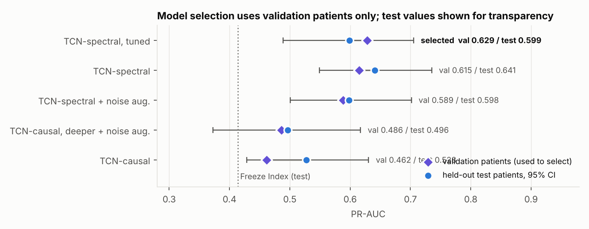
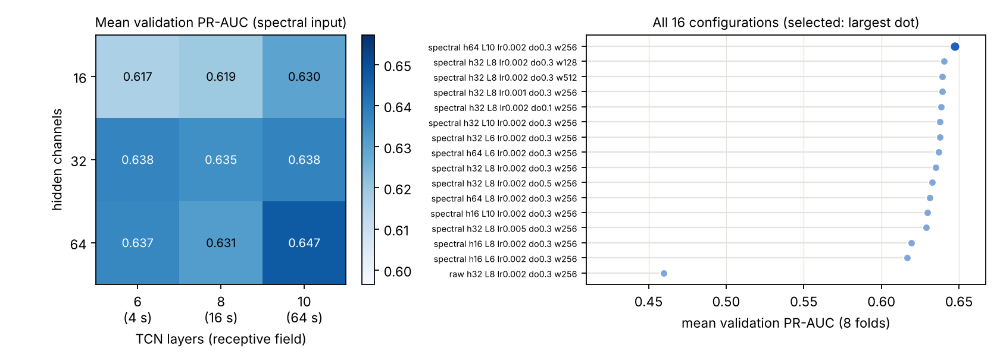
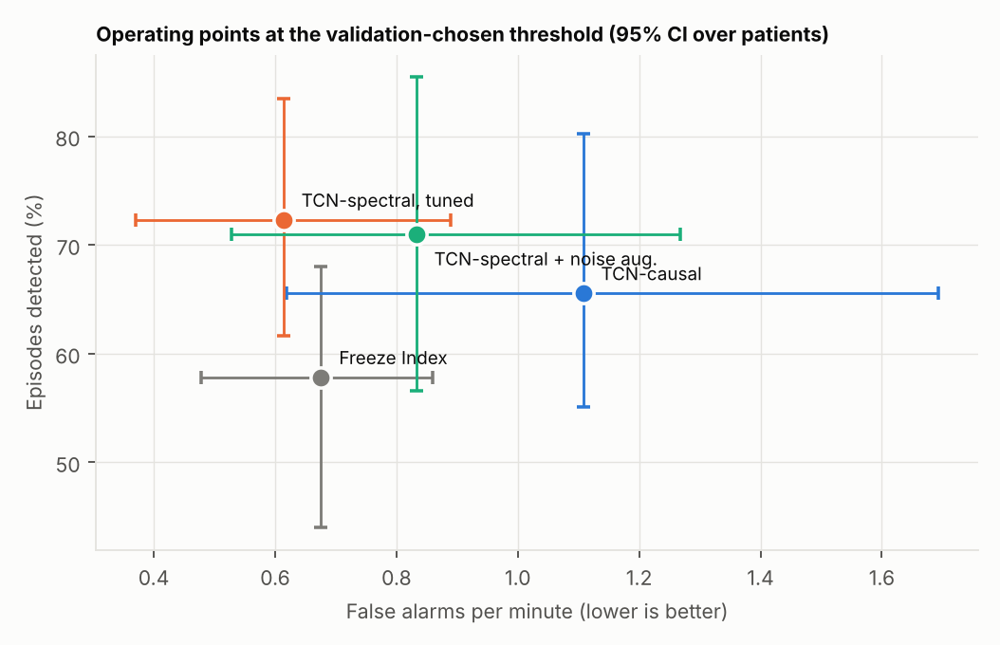
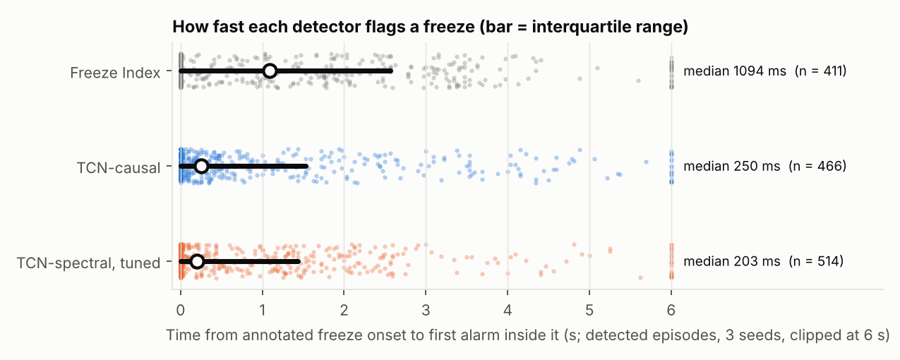
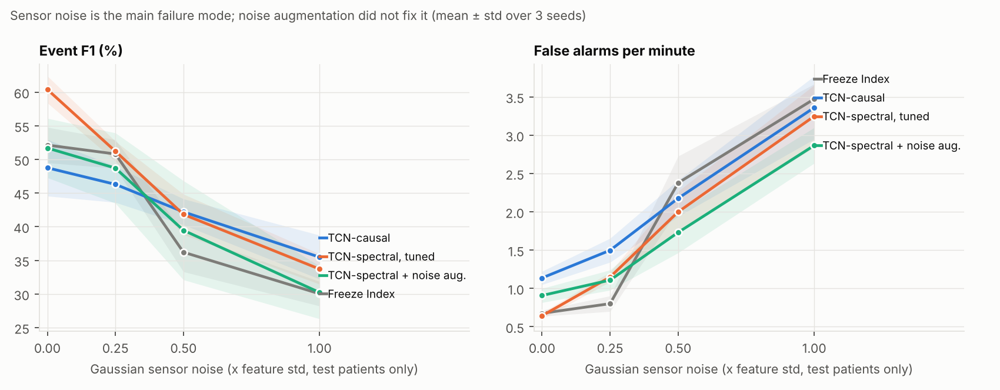
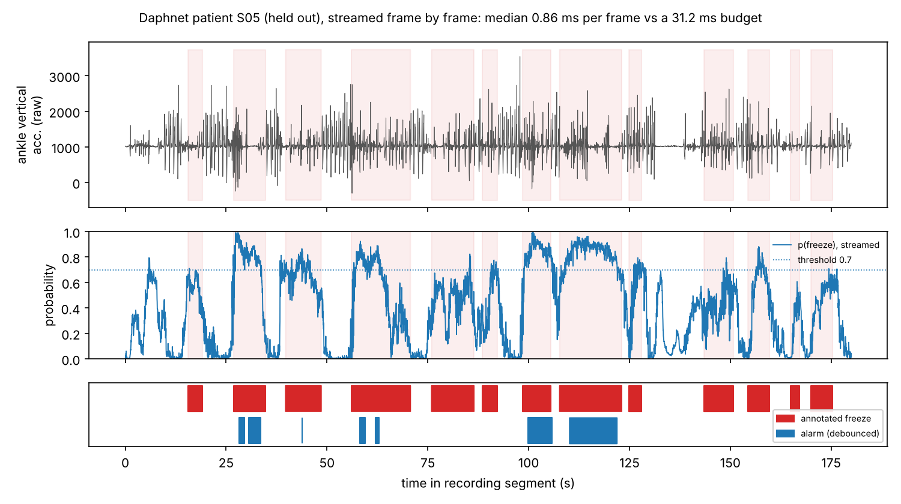

[](https://github.com/ZeynepHusnaKocacenk/realtime-surgical-gesture-jigsaws/actions/workflows/tests.yml)
[](https://zeynephusnakocacenk.github.io/realtime-surgical-gesture-jigsaws/)

# Real-Time Causal Sequence Models for Clinical Event Detection

**Detecting freezing of gait in Parkinson's disease from wearable sensors, frame by frame, within a 31 ms budget, evaluated on patients the model has never seen. The same framework is ready for surgical gesture and skill recognition on JIGSAWS (awaiting data access).**

> **Abstract.** Most published detectors are evaluated offline: the model sees a whole recording, then
> labels it. A wearable or operating-room system must decide at time *t* from samples up to *t*, within a
> fixed time budget, for a patient it has never seen. This project builds causal sequence models that
> stream one frame at a time in constant time and evaluates them the way they would be deployed: leave one
> patient out, every choice (including the model and its hyperparameters) made on separate validation
> patients, event-level metrics, 95% confidence intervals over patients, calibration, abstention and
> simulated sensor faults. On the Daphnet dataset (10 patients, 237 freezing episodes), the model selected
> on validation patients, a causal TCN with spectral input features, raises freeze alarms with higher event
> F1 than the clinical-signal baseline (the Freeze Index): **61.2 vs 52.1, paired difference +9.1
> [+2.8, +14.5]**, with better frame ranking in **all 8 held-out patients**, fewer false alarms, and alarms
> about 0.9 s earlier, at about 1 ms of compute per 31 ms frame. A LangGraph agent turns each session into a
> reviewer-ready summary whose every number is checked against the detector output. Research prototype;
> no clinical claims.

## Key results (8 held-out patients, 3 seeds, 95% CI over patients)

| | Freeze Index (baseline) | **Selected model: TCN-spectral, tuned** | Paired difference |
|---|---|---|---|
| Event F1 (alarm level) | 52.1 [40.7, 58.2] | **61.2** [48.5, 68.4] | **+9.1** [+2.8, +14.5]; better in 7/8 patients |
| PR-AUC (ranking of freeze frames) | 0.414 [0.290, 0.528] | **0.599** [0.489, 0.705] | **+0.185** [+0.108, +0.270]; better in **8/8** patients, exact Wilcoxon p = 0.008 |
| Episodes detected | 57.8% | 72.3% | |
| Alarm precision | 47.5% | 53.1% | |
| False alarms per minute | 0.68 | 0.61 | |
| Median time to flag a freeze | 1094 ms | 203 ms | |
| Compute per 31.25 ms frame | one FFT | 1.0 ms (eager PyTorch, CPU), constant over time | |



**Honest reading.** The ranking gain is consistent across every patient. The alarm-level gain has a
bootstrap CI above zero, but one patient (S01) goes the other way, so the exact rank test over 8 patients
gives p = 0.148: likely, not proven. Under a stricter one-to-one event matching the two are close
(42.0 vs 40.3, +1.7 [-3.6, +7.1]), because the learned model sometimes splits one long freeze into two alarms.

---

## 1. What this project is aiming at

**The clinical problem.** Freezing of gait (FoG) is a sudden, brief inability to step forward that affects
many people with Parkinson's disease and is a leading cause of falls. Rhythmic cues (a beat, a vibration)
delivered at the moment of a freeze can help a person start walking again. That needs a detector that works
**in real time on a wearable**, for **a person it was not trained on**.

**The methodological problem.** Many reported FoG and surgical-gesture results use evaluation a deployed
system could not reproduce: the model sees future samples, the same person appears in training and test
data, or thresholds and models are tuned on the test data. Such numbers do not predict deployed performance.

**Aims:**

1. Build models that use only the past and run in **constant time per frame**, and prove it with tests.
2. Evaluate them **as they would be deployed**: unseen patients, every decision fixed on separate validation
   patients, event-level metrics a clinician understands (episodes caught, false alarms per minute, delay),
   and uncertainty across patients.
3. **Improve the model systematically** (feature design, ablations, a hyperparameter search) without ever
   letting the test patients influence a choice.
4. Measure what matters for a medical device beyond accuracy: **calibration, abstention, robustness to sensor
   faults, latency, model export**, documented in a **model card**.
5. Show how a **language-model agent** can sit on top of a medical signal pipeline **safely**: it writes,
   code computes, and a verifier blocks invented numbers and clinical advice.
6. Apply the same real-time framework to **surgical gesture and skill recognition (JIGSAWS)** once the data
   is available; the pipeline, configs and leakage tests are ready.

## 2. What was done, step by step

| Step | What | Where |
|---|---|---|
| 1 | Load Daphnet (3 accelerometers at 64 Hz), drop unannotated frames, split at gaps, average to 32 Hz (causal; 31.25 ms per frame) | `rtsurg/daphnet.py` |
| 2 | Leave-one-patient-out folds; in each fold 2 other patients become **validation patients** used for every choice; the test patient is never used for any choice | `loso_splits`, `tests/test_daphnet.py` |
| 3 | Baseline: the **Freeze Index** (Moore et al., 2008), thresholds tuned on validation patients | `freeze_index`, `select_fi_thresholds` |
| 4 | Learned models: causal TCN with per-layer streaming caches, LSTM; acausal TCN and BiLSTM for comparison | `rtsurg/models.py` |
| 5 | Event metrics (lenient and strict), threshold and debounce selection on validation patients | `rtsurg/fog.py` |
| 6 | Model development: causal spectral input features, deeper receptive field, noise augmentation (4 variants + ablations) | `rtsurg/features.py`, `configs/daphnet_*.yaml` |
| 7 | **Hyperparameter search**: 16 configurations, scored on validation patients only; winner run on the full protocol | `rtsurg/hparam_search.py` |
| 8 | **Model selection** across all variants by mean validation PR-AUC | `rtsurg/fog_summary.py` |
| 9 | Uncertainty: bootstrap over patients, paired comparisons, exact Wilcoxon test | `rtsurg/stats.py` |
| 10 | Calibration (temperature scaling), abstention, simulated sensor faults | `rtsurg/robust_run.py` |
| 11 | Deployment: one streaming step exported to TorchScript, ONNX and int8 ONNX | `export.py` |
| 12 | Real-data streaming demo on a held-out patient | `demo_daphnet.py` |
| 13 | LangGraph session-report agent with a verification gate | `rtsurg/report_agent.py` |
| 14 | Figures, model card, technical report, project page | `rtsurg/analysis_figures.py`, `MODEL_CARD.md`, `docs/` |



## 3. How the evaluation works

* **Patients, not frames, are the unit.** For each of the 8 patients who froze, that patient is the test set;
  two other freezing patients (drawn by seed) are validation patients; the rest train. S04 and S10 never froze
  and only train. 3 seeds change the validation draw, initialisation and data order.
* **Every choice on validation patients:** training epoch, decision threshold, alarm debounce, Freeze Index
  thresholds, temperature, abstention level, model variant and hyperparameters. A test checks that the
  hyperparameter search never touches a fold's test patient.
* **Event metrics.** A predicted event is a run of alarm frames (runs less than 1 s apart merged). It is
  *correct* only if at least half its frames are annotated freeze, so an always-on detector scores nothing.
  An episode is *detected* if an alarm frame falls inside it. A **strict** one-to-one matching is reported
  alongside, because the lenient version can reward splitting one freeze into several alarms.
* **Uncertainty.** 95% CIs resample the 8 test patients (2000 times); paired comparisons resample the same
  patients for both detectors. With 8 patients the smallest possible Wilcoxon p-value is 0.008.

## 4. Model development: what was tried and how the model was chosen

### 4.1 Variants (each on the full 3-seed protocol)

| Variant (all causal TCNs) | Validation PR-AUC (used to choose) | Test PR-AUC [95% CI] | Test event F1 [95% CI] | False alarms / min |
|---|---|---|---|---|
| TCN-causal: 6 layers (4 s), raw input, 12 epochs | 0.462 | 0.528 [0.429, 0.631] | 48.1 [34.0, 59.3] | 1.11 |
| + deeper (8 layers, 16 s) + noise augmentation, raw input | 0.486 | 0.496 [0.372, 0.617] | 47.8 [32.4, 61.0] | 0.85 |
| + deeper + spectral features + noise augmentation | 0.589 | 0.598 [0.501, 0.702] | 52.0 [35.9, 64.3] | 0.83 |
| TCN-spectral: deeper + spectral features | 0.615 | 0.641 [0.549, 0.735] | 58.5 [43.7, 68.1] | 0.63 |
| **TCN-spectral, tuned** (search winner: 64 channels, 10 layers, 64 s) | **0.629** | 0.599 [0.489, 0.705] | **61.2** [48.5, 68.4] | **0.61** |



### 4.2 Hyperparameter search (validation patients only)

16 configurations x 8 folds: a 3 x 3 grid of width (16, 32, 64 channels) x depth (6, 8, 10 layers, i.e. 4 s,
16 s and 64 s of memory), plus learning rate (0.001, 0.002, 0.005), dropout (0.1, 0.3, 0.5), training window
(4, 8, 16 s) and raw vs spectral input. Each configuration is trained per fold and scored on that fold's
validation patients; the test patient is never loaded. Full table: [`results/hparam_search/search.md`](results/hparam_search/search.md).



**What the search and ablations show**

* **Input representation matters most.** Every spectral configuration scores 0.617 to 0.647 validation PR-AUC;
  the same network on raw accelerations scores 0.460. Giving the network the causal log power in the
  locomotor (0.5 to 3 Hz) and freeze (3 to 8 Hz) bands, the ingredients of the Freeze Index, is the change that
  helped; a small network trained on 7 patients does not rediscover that frequency shift from raw signals.
* **Size, learning rate, dropout and window are a plateau** (within 0.03 of each other). The largest model
  (64 channels, 10 layers, 171k parameters) is best on validation and was selected by the pre-stated rule.
* **Noise augmentation hurt** clean accuracy and did not make the model more robust to noise (section 6).
* **Validation and test do not agree on everything.** The selected model has the best test event F1, the
  lowest false-alarm rate and the highest precision, but untuned TCN-spectral has a higher test PR-AUC (0.641 vs
  0.599, inside each other's CIs). Choosing by test numbers would be test-set selection, so the rule stands.

## 5. Results

### All detectors (online, threshold chosen on validation patients)

Full table with every operating point: [`results/daphnet_summary.md`](results/daphnet_summary.md).

| Detector | Event F1 [95% CI] | Strict F1 | Recall | Precision | False alarms / min | PR-AUC [95% CI] |
|---|---|---|---|---|---|---|
| Freeze Index (baseline) | 52.1 [40.7, 58.2] | 40.3 | 57.8 | 47.5 | 0.68 | 0.414 [0.290, 0.528] |
| **TCN-spectral, tuned** (causal, selected) | **61.2** [48.5, 68.4] | **42.0** | **72.3** | **53.1** | **0.61** | 0.599 [0.489, 0.705] |
| TCN-spectral (causal) | 58.5 [43.7, 68.1] | 40.8 | 70.7 | 50.1 | 0.63 | 0.641 [0.549, 0.735] |
| TCN-causal (causal, raw input) | 48.1 [34.0, 59.3] | 36.2 | 65.5 | 38.3 | 1.11 | 0.528 [0.429, 0.631] |
| TCN-acausal (re-run on the last 10 s every 250 ms) | 47.5 [34.1, 57.0] | 35.9 | 61.0 | 39.9 | 1.00 | 0.520 [0.409, 0.638] |
| BiLSTM (acausal) | 35.7 [21.3, 49.0] | 24.6 | 61.6 | 25.2 | 1.60 | 0.363 [0.253, 0.486] |
| LSTM (causal) | 26.7 [16.7, 39.5] | 18.5 | 57.0 | 17.6 | 1.63 | 0.376 [0.273, 0.479] |

| | |
|---|---|
|  |  |

* **Causal is enough.** Models that cannot see the future lose nothing here; acausal models must be re-run on
  recent history online and do no better.
* **Earlier alarms.** The selected model flags a freeze a median 203 ms after it starts; the Freeze Index needs
  about 1.1 s because its 4 s window must fill with freeze-band power.
* **Per patient** event F1 ranges from 23 to 76 for the selected model and 20 to 64 for the Freeze Index;
  patient S01 is hard for every learned model. Between-patient variation is the main source of uncertainty.
* **What did not help:** a validation-chosen minimum alarm duration (debounce) helps the Freeze Index (55.0)
  but not the learned models; LSTMs are clearly worse on this task.

## 6. Calibration, abstention and sensor faults



* **Dropped frames** (up to 20%) and **stuck sensors** (up to 3 s) barely change any detector.
* **Gaussian noise is the failure mode** for every detector: at noise of 1x the feature standard deviation,
  false alarms rise about 3 to 5 times (selected model 0.64 to 3.25 per minute; Freeze Index 0.68 to 3.47) and
  event F1 falls to about 30 to 35. The selected model still leads the Freeze Index at every noise level
  (33.7 vs 30.0 at 1x). Spectral features import part of the Freeze Index's weakness (noise adds freeze-band
  power); noise augmentation during training did not fix it.
* **Calibration.** Temperature scaling on two validation patients lowers the log-loss and ECE a little
  (selected model 8.8% to 7.4%), but the temperature varies between folds (2.1 ± 1.0): probabilities are not
  calibrated risk for a new patient.
* **Abstention** (no alarm when unsure) cuts false alarms but misses more freezes; validation never chose it.
  Details: [`results/daphnet_tuned/robustness.md`](results/daphnet_tuned/robustness.md), [`results/daphnet/robustness.md`](results/daphnet/robustness.md).

## 7. Real-data streaming demo

```bash
python demo_daphnet.py --data-dir data/daphnet        # Daphnet from the UCI repository; not included here
```

Replays held-out patient S05 (a typical patient, not the best one) frame by frame through the shipped
checkpoint of the selected model (`assets/`, trained without S05; threshold and debounce from that fold's
validation patients), checks streamed output against the offline pass (max difference 3e-7) and writes a
timeline and a session summary to `docs/demo/`. All 66,880 frames were processed within the 31.25 ms budget.



With this fold's validation-chosen threshold (0.7, 1 s debounce) the model is conservative for S05: 7 false
alarms in 35 minutes, but it catches the long freezes and misses many short ones (22 of 66 episodes).

## 8. Session-report agent (LangGraph + Claude, with guardrails)

`rtsurg/report_agent.py` turns a session's per-frame output into a short summary for a research team. It
assumes a language model is good at prose and must not be trusted with numbers or clinical judgement:

* **analyze** (code) computes the facts: alarms, timings, confidence, stuck-sensor checks, and agreement with
  the annotation when available. The model never sees raw signals and never computes anything.
* **draft** (Claude `claude-opus-5-5` through the official `anthropic` SDK, server-side refusal fallback on)
  writes four fixed sections from the facts.
* **verify** (code) rejects any number or time stamp not in the facts, any diagnostic, treatment, medication or
  dosing language, missing sections, and drafts that ignore a quality flag.
* **revise** returns the findings to the model (append-only history), at most twice; after that, or on a refusal
  or API error, a deterministic **template** writes the summary. A disclaimer is always appended.

Without an API key the template writer stands in for Claude, so the graph runs and is tested offline
(`tests/test_report_agent.py`: invented numbers, invented time stamps and dosing advice are caught; revision
and fallback work). Example: [`docs/demo/session_S05.md`](docs/demo/session_S05.md). The live Claude path
needs `ANTHROPIC_API_KEY` and has not been run in CI.

## 9. Deployment (design proposal)

`python export.py --data-dir <daphnet folder>` exports each causal model as one streaming step (frame + state
in, logits + state out) to TorchScript, ONNX and dynamic int8 ONNX, verifies outputs against PyTorch and
benchmarks one CPU thread ([`results/deployment.md`](results/deployment.md)). For the baseline TCN, ONNX Runtime
takes 0.042 ms per frame (about 10x faster than eager PyTorch); int8 halves the file size with a 0.2 point F1
change but is slower at this tiny size. The selected model (171k parameters plus one 64-point FFT per axis per
frame) takes about 1 ms per frame in eager PyTorch and is not yet exported. Nothing has been tested on a device
or with patients.

## 10. JIGSAWS: surgical gesture and skill recognition (awaiting data)

The same causal and acausal models, trained jointly for frame-wise gesture recognition and trial-level skill
(novice, intermediate, expert) on da Vinci kinematics, evaluated offline and online with frame accuracy, edit
score, F1@{10, 25, 50}, gesture detection delay, early skill accuracy and latency. Two protocols: **LOUO** (leave
one surgeon out) and **LOSO** (leave one supertrial out, `--protocol loso`, the protocol most published gesture
results use).

```bash
python run_jigsaws.py --root /path/to/JIGSAWS --check   # validates folders, prints a data summary
python run_jigsaws.py --root /path/to/JIGSAWS --quick   # sanity run, not a result
python run_jigsaws.py --root /path/to/JIGSAWS           # 3 tasks x 3 seeds x 4 models (LOUO)
python main.py --config configs/jigsaws_suturing.yaml --data-dir /path/to/JIGSAWS/Suturing --protocol loso
```

The loader has only been tested on generated files in the documented layout. The data must never be committed
(its licence forbids redistribution). No JIGSAWS number appears anywhere until a real run exists, and a test
stops synthetic numbers from being shown as results.

## 11. Reproduce

```bash
pip install -r requirements.txt
python -m pytest -q tests                 # 50 tests: leakage, causality, streaming equality, metrics, stats, agent
./run_all.sh                              # every config; skips training when saved results match the config
python -m rtsurg.hparam_search            # validation-only hyperparameter search (about 2 h on 4 cores)
python -m rtsurg.fog_summary              # headline table, CIs, paired tests, validation-based model selection
python -m rtsurg.analysis_figures         # figures in docs/figures/analysis/
python make_report.py                     # docs/index.html (GitHub Pages)
```

Each Daphnet configuration takes 15 to 60 minutes on 4 CPU cores. Re-running the original baseline in this
revision reproduced all 216 of its per-fold result rows exactly (same event counts, same thresholds).

## 12. What is missing (roadmap)

* **External validation:** train on Daphnet, test on a second FoG dataset (for example the Michael J. Fox
  Foundation tDCS FoG / DeFOG recordings, lower-back sensor). The most valuable next step.
* **More patients:** 8 test patients cannot resolve differences below about 10 F1 points.
* **Real sensor faults** instead of simulated ones, and features that stay robust under noise.
* **Per-patient calibration** from a short enrolment recording; probabilities are not calibrated today.
* **Export the selected model** (featurizer + network) to ONNX and measure it on an embedded board.
* **JIGSAWS results** once data access is granted; then video features.
* **Live run of the agent** with an API key, plus an evaluation set for its summaries.

## Documentation

* [`docs/technical_report.md`](docs/technical_report.md): methods, all results, review and audit notes.
* [`MODEL_CARD.md`](MODEL_CARD.md): intended use, data, performance, failure modes.
* [`CITATION.cff`](CITATION.cff): how to cite.

## Project structure

```
rtsurg/
  daphnet.py         Daphnet loader, leave-one-patient-out splits with validation patients, Freeze Index
  features.py        causal spectral features (log band powers, log Freeze Index)
  models.py          causal/acausal TCN, LSTM/BiLSTM, constant-time streaming API
  fog.py             event metrics (lenient and strict), debounce, threshold selection, training
  fog_run.py         Daphnet benchmark driver;  fog_report.py: per-run tables and figures
  hparam_search.py   validation-only hyperparameter search
  stats.py           patient-level bootstrap CIs, paired comparisons, exact Wilcoxon test
  fog_summary.py     headline table across runs and validation-based model selection
  analysis_figures.py  figures for the README and project page
  calibration.py, robustness.py, robust_run.py, robust_report.py   calibration, faults, abstention
  report_agent.py    LangGraph session-report agent with a verification gate
  data.py, train.py, metrics.py, benchmark.py, jigsaws_check.py    JIGSAWS pipeline (LOUO and LOSO)
configs/             one YAML per experiment
demo_daphnet.py      real-data streaming demo;  demo_stream.py: synthetic JIGSAWS-format demo
export.py            ONNX / TorchScript / int8 export and latency benchmark
main.py, run_all.sh, run_jigsaws.py, a.py, make_report.py
tests/               50 tests
```

## Limitations

* 8 evaluable patients from one lab study with walking tasks designed to provoke freezing. Nothing here
  transfers to free-living use, other devices or other populations, and nothing is a clinical claim.
* Sensor faults are simulated. Latency was measured on a shared cloud CPU.

## References

* M. Bachlin et al. *Wearable assistant for Parkinson's disease patients with the freezing of gait symptom.* IEEE TITB, 2010.
* S. T. Moore, H. G. MacDougall, W. G. Ondo. *Ambulatory monitoring of freezing of gait in Parkinson's disease.* J. Neurosci. Methods, 2008.
* Y. Gao et al. *JIGSAWS: A Surgical Activity Dataset for Human Motion Modeling.* MICCAI M2CAI Workshop, 2014.
* N. Ahmidi et al. *A Dataset and Benchmarks for Segmentation and Recognition of Gestures in Robotic Surgery.* IEEE TBME, 2017.
* C. Lea et al. *Temporal Convolutional Networks for Action Segmentation and Detection.* CVPR, 2017.
* Y. Abu Farha, J. Gall. *MS-TCN: Multi-Stage Temporal Convolutional Network for Action Segmentation.* CVPR, 2019.
* M. Mitchell et al. *Model Cards for Model Reporting.* FAT*, 2019.

## Author

Zeynep Kocacenk, B.Sc. Computer Science (Psychology minor), Carleton University. This project extends my
undergraduate thesis, a real-time surgical skill classification pipeline inside 3D Slicer
([repo](https://github.com/ZeynepHusnaKocacenk/realtime-surgical-skill-analysis-3dslicer)).
